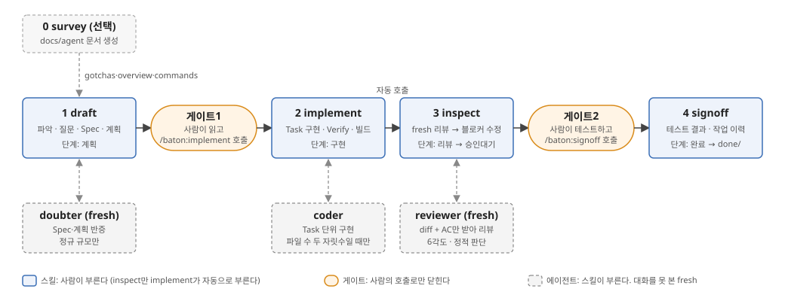
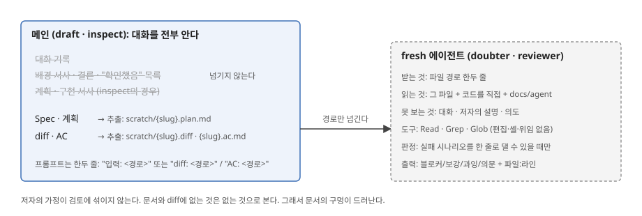
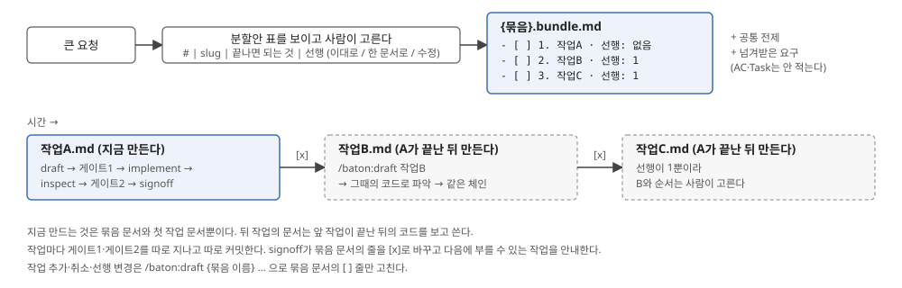
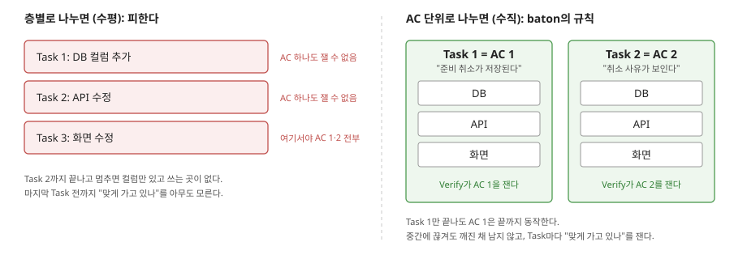
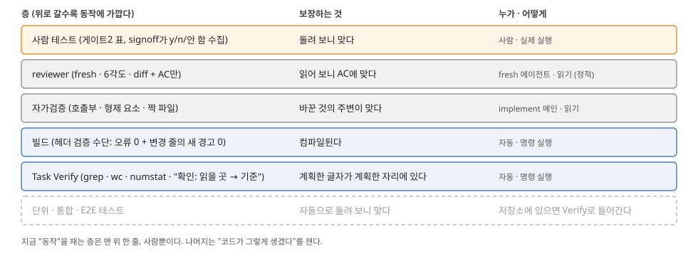

# baton 작업 흐름 안내

갱신일: 2026-10-16 (baton 0.3.0 기준)

## 이 문서는

**baton**은 Claude Code(Anthropic의 터미널용 AI 코딩 도구) 위에서 도는 플러그인이다. "코드를 고쳐 줘"라는 요청을 **계획 → 구현 → 리뷰 → 종결**의 네 단계로 나누고, 그 사이에 **사람이 멈춰서 승인하는 자리(게이트)** 둘을 둔다. 목적은 두 가지다. AI가 합의되지 않은 것을 멋대로 하지 않게 하는 것, 그리고 무엇을 확인했고 무엇을 확인하지 못했는지가 문서에 남게 하는 것이다.

이 문서는 baton이 요청 하나를 받아 `완료`로 보내기까지 **무엇을, 어떤 순서로, 왜** 하는지 풀어 쓴 것이다. baton을 처음 보는 사람, 또는 baton으로 만든 작업 문서를 읽어야 하는 사람을 위해 썼다.

- 규칙의 원문은 `skills/*/SKILL.md`와 `agents/*.md`에 있다. 이 문서는 그것을 읽기 쉽게 재구성한 것이라, **이 문서와 원문이 다르면 원문이 맞다.**
- 0장·4장·5장·8장·11장과 그림에 나오는 "대출 준비 취소" 예시는 설명을 위해 지어낸 것이다. 특정 저장소의 실제 코드가 아니다.
- 8장의 "현재 한계"는 규칙이 아니라 규칙을 읽고 끌어낸 **평가**다. 그렇게 표시해 두었다.
- 설치와 호출 방법은 `README.md`에 있다.

읽는 순서: 0장으로 전체 모양을 잡고, 4~7장에서 단계마다 들어가고, 8장에서 "검증이 어디까지 보나"를 확인한다. 세션을 넘길 일이 있으면 10장(handoff)을 본다. 용어가 낯설면 11장을 먼저 본다.

미리 알아 둘 Claude Code 용어 셋:

| 용어 | 뜻 |
|---|---|
| **스킬** | 사람이 `/이름`으로 부르는 명령. baton의 스킬은 `/baton:draft`처럼 쓴다. 스킬 하나의 규칙이 `SKILL.md` 파일 하나다 |
| **에이전트** | 스킬이 일을 맡기려고 띄우는 별도의 AI. 자기 대화와 자기 도구만 가진다 |
| **세션** | 사람과 Claude Code 사이의 대화 하나. `/clear`로 비우면 이전 대화를 기억하지 않는다 |

---

## 0. 한눈에 보기



### 0.1 사람이 실제로 하는 일

작업 하나가 지나가는 동안 사람이 치는 명령은 셋, 결정하는 자리는 둘이다. 예시로 보면 이렇다.

```
사람   /baton:draft 도서 대출 준비를 취소할 수 있게 해 줘
baton  코드를 읽는다 → 결과가 달라지는 것만 묻는다(선택지 2~4개) → 작업 문서를 쓴다
       → [게이트1] "이렇게 만들겠다": 완료 기준(AC) · 사람이 테스트할 것 · 바꿀 파일 · 돌릴 명령

사람   읽고 고칠 것을 말한다 (baton이 문서를 고쳐 다시 보여 준다)
       또는 승인: /clear 후  /baton:implement loan-cancel-ready
baton  Task 순서대로 구현 → Task마다 검증 명령 실행 → 빌드
       → (자동으로) 새 눈의 리뷰 → 지적 수정 → 다시 리뷰
       → [게이트2] "다 됐다, 이것을 해 봐 달라": AC 판정 · 사람 테스트 표 · 커밋 초안

사람   표대로 실제로 돌려 본다 → /baton:signoff loan-cancel-ready
baton  항목마다 "기대대로였나?" y/n을 묻는다 → 작업 이력에 한 줄 → 문서를 done/으로
       → (저장소 문서에 넣을 교훈이 있으면 제안)

사람   커밋한다
```

위 예시에서 `loan-cancel-ready`가 **slug**(작업 문서의 파일 이름이자 작업의 이름)이고, **Task**는 계획을 구현 순서대로 쪼갠 단위다. 게이트1에서 "아니다"가 나오면 baton은 **문서를 고쳐 다시 보여 줄 뿐 구현을 시작하지 않는다.** 게이트2에서 테스트가 기대와 다르면 사람이 `/baton:inspect <slug> <달랐던 것>`으로 되돌린다(9장).

### 0.2 기억할 세 가지

세 가지만 기억하면 나머지는 따라온다.

1. **단계는 넷, 게이트는 둘.** `draft`(계획) → 게이트1 → `implement`(구현) → `inspect`(리뷰) → 게이트2 → `signoff`(종결). 게이트는 사람이 멈춰서 읽고 결정하는 자리다.
2. **승인은 말이 아니라 호출이다.** "좋아요"라고 답해도 게이트는 안 열린다. 사람이 `/baton:implement`를 부르면 게이트1이, `/baton:signoff`를 부르면 게이트2가 닫힌다. 모델이 스스로 이어 가는 구간은 `implement → inspect` 하나뿐이다.
3. **검토자는 대화를 못 본다.** 계획을 반박하는 `doubter`, 코드를 리뷰하는 `reviewer`는 작성자의 설명 없이 **문서와 코드만** 받는다. 그래서 작성자의 가정이 검토에 섞이지 않는다.

작업 문서의 `단계:` 값은 이렇게 바뀐다.

| 단계 값 | 누가 적나 | 뜻 |
|---|---|---|
| `계획` | draft | 게이트1 제시 끝. 사람의 `/baton:implement`를 기다린다 |
| `구현` | implement | Task 전부 끝나고 빌드 통과. inspect로 넘어간다 |
| `리뷰` | inspect | reviewer가 보는 중, 또는 리뷰 지적을 고치는 중 |
| `승인대기` | inspect | 게이트2 제시 끝. 사람의 테스트와 `/baton:signoff`를 기다린다 |
| `완료` | signoff | 문서가 `done/`으로 이동 |

---

## 1. 등장인물

| 이름 | 종류 | 누가 부르나 | 받는 것 | 내놓는 것 |
|---|---|---|---|---|
| `survey` | 스킬 | 사람 (처음 한 번, 이후 갱신) | 저장소 | `docs/agent/` 문서 5종 + 얇은 `AGENTS.md`·`CLAUDE.md` |
| `draft` | 스킬 | 사람 | 작업 요청 한 줄 | 작업 문서 `{slug}.md` (배경·Spec·계획), 게이트1 메시지 |
| `implement` | 스킬 | 사람 (= 게이트1 승인) | slug | 코드 변경, `## 구현` 기록, 그리고 inspect 자동 호출 |
| `inspect` | 스킬 | implement가 자동으로, 또는 게이트2 뒤 사람이 | slug (+ 지적) | `## 리뷰 n회차`, `## 인계`, 게이트2 메시지 |
| `signoff` | 스킬 | 사람 (= 게이트2 승인) | slug (+ 테스트 결과) | 작업 이력 한 줄, `## 종결`, `done/` 이동 |
| `handoff` | 스킬 | 사람, 또는 모델 스스로 (체인 밖) | 다음에 집중할 것 (선택) | 인계 문서 `handoff/{주제}.md` (10장) |
| `doubter` | 에이전트 | draft (정규 규모만, 4.5절) | Spec·계획 추출 파일 경로 | 블로커 / 보강 / 과잉 / 의문 |
| `reviewer` | 에이전트 | inspect | diff 파일 + AC 파일 경로 | Critical / Important / Suggestion / 의문 |
| `checker` | 에이전트 | survey | 방금 쓴 문서 경로 | 블로커 / 보강 / 의문 / 확인 불가 |
| `coder` | 에이전트 | implement (파일 수 두 자릿수일 때만) | 문서 경로 + Task 번호 | 변경 파일, Verify 결과, 빌드 결과 |

survey와 체인 네 스킬이 뼈대이고, handoff는 체인 밖에서 세션을 넘길 때 쓰는 보조 스킬이다. 네 에이전트는 스킬이 일부 일을 맡기는 조수다. 에이전트의 출력에 나오는 **블로커**는 "고치기 전에는 다음으로 못 넘어가는 지적", **Critical / Important / Suggestion**은 리뷰 지적의 심각도 세 단계다.

**fresh**란 "이 대화를 못 본 새 눈"이라는 뜻이다. `doubter`·`reviewer`·`checker`는 도구가 `Read`·`Grep`·`Glob`뿐이라 **읽기만** 할 수 있고, 프롬프트도 "입력: 경로" 한두 줄만 받는다.



왜 이렇게 하나. 작성자가 "확인했다"고 생각한 것을 그대로 넘기면 검토자도 그걸 믿는다. 경로만 넘기면 검토자는 코드를 직접 열어 대조할 수밖에 없고, **문서에 안 적힌 것은 없는 것으로** 본다. 그래서 문서의 구멍이 드러난다.

---

## 2. 작업 폴더와 작업 문서

프로젝트 루트의 `.claude/work/` 아래에만 쓴다.

```
.claude/work/
  {slug}.md            작업 문서 하나 = 작업 하나. 체인 전체가 이 파일에 덧붙여 쓴다
  {묶음}.bundle.md     큰 요청을 나눴을 때의 목록 (4.3절)
  scratch/             fresh 에이전트에 넘길 추출본. signoff가 지운다
  snapshots/{slug}/    구현 전 사본. git이 아니거나 미커밋 변경이 있을 때만
  ledger.md            작업당 한 줄씩 남는 작업 이력
  done/                끝난 작업 문서
  handoff/             세션 인계 문서 (체인 밖, 10장)
```

작업 문서는 체인이 지나가며 **절(section)이 늘어나는** 문서다. 누가 어느 절을 쓰는지가 정해져 있다.

| 절 | 쓰는 단계 | 담는 것 |
|---|---|---|
| 헤더 (`단계:`·`규모:`·`유형:`·`대상:`·`검증 수단:`·`준비:`·`동기화:`) | draft | 이 작업의 성격과 **실행이 허용된 명령** |
| `## 배경` | draft | 지금 코드가 어떻게 돼 있나, `파일:라인` |
| `## Spec` (AC · 사람 테스트 · 전제 · 범위 밖 · OQ) | draft | 무엇이 돼야 하나 (각 항목은 4.4절) |
| `## 계획` (Task마다 AC · Files · Verify) | draft | 어떻게 할 건가, 어떻게 잴 건가. **Verify**는 그 Task가 됐는지 재는 명령과 기대 결과 (4.6절) |
| `## 검증` | draft | doubter의 반증 결과 요약 (정규만) |
| `## 구현 메모` | draft | 구현자가 헤맬 것만, 최대 5줄 |
| `## 구현` | implement | Task별 Verify 결과, 빌드 결과, 변경 파일 |
| `## 리뷰 n회차` | inspect | reviewer 결과와 조치 |
| `## 인계` | inspect | 게이트2에서 사람이 볼 것 (= 게이트2 메시지와 같은 내용) |
| `## 종결` | signoff | 테스트 결과 요약, 커밋 상태 |

헤더 중 셋은 특별히 중요하다. **`검증 수단:`·`준비:`와 Task의 Verify는 implement가 실행할 수 있는 명령의 전부**다. 게이트1에서 사람이 본 명령이 곧 승인된 명령이고, 거기 없는 설치·배포·DB 변경·외부 호출은 README에 적혀 있어도 돌리지 않고 멈춰서 묻는다.

---

## 3. 준비: survey (선택)

`/baton:survey`는 체인 밖의 준비 단계다. 저장소를 분석해서 에이전트가 읽을 프로젝트 문서를 만든다. 없어도 체인은 돌지만, 있으면 draft와 검토자들이 더 정확해진다.

```
docs/agent/
  overview.md     목적 · 구조 지도 · 진입점 · 대표 요청 흐름      → draft가 고칠 위치를 찾을 때
  commands.md     빌드 · 테스트 · 린트 명령, 실행 확인 여부        → draft가 검증 수단을 고를 때
  conventions.md  판단이 필요한 코드 관행 (예시 2곳 이상)           → doubter·reviewer가 대조할 때
  gotchas.md      코드로는 알 수 없는데 모르면 달리 행동하는 것      → 모든 단계가 먼저 읽는다
  domain.md       도메인 용어집 (있을 때만)
```

`gotchas.md`는 네 구역과 질문 하나로 나뉜다.

| 구역 | 무엇이 그렇게 만드나 | 예 |
|---|---|---|
| `## 함정` | 코드·도구의 동작 | "`sed -i`를 쓰면 CRLF가 LF로 바뀐다" |
| `## 환경` | 이 기계·배포·저장소의 상태 | "Development 연결 문자열은 공유 DB를 가리킨다" |
| `## 경계` | 사람이 정한 범위 | "`vendor/`는 고치지 않는다" |
| `## 결정` | 과거의 선택 (되돌리기 어렵고, 맥락 없이 이상해 보이고, 실제 대안이 있었을 때만) | "ORM 대신 raw SQL을 쓴다. 이유: …" |
| `## 확인 못 함` | 근거를 못 찾은 질문 | "Local 프로필의 DB는 개인용인가?" |

모든 문장에 근거(`파일#심볼`, `파일:라인`, 명령 결과, 또는 `답: {사람} {날짜}`)가 붙어야 하고, 근거를 못 대면 본문이 아니라 `## 확인 못 함`에 질문으로 남긴다. 쓴 뒤에는 `checker`가 저장소와 대조해서 근거 불일치·추론을 잡는다.

`## 확인 못 함`의 질문은 나중에 **draft가 그 대상을 고칠 때 같이 묻고**, 답은 작업 문서의 `### 전제`에 `(확인 못 함의 답 날짜)`를 붙여 적히며, **signoff가 그 답으로 질문을 대체할 한 줄을 제안**한다. 질문이 답으로 바뀌는 길이 체인 안에 있다.

---

## 4. 1단계 draft: 요구를 분석하고 쪼갠다

`/baton:draft <요청>`. 사람만 부른다. 끝나면 `단계: 계획`으로 멈추고 게이트1을 제시한다. **구현은 절대 시작하지 않는다.**

진입할 때 요청의 첫 낱말을 보고 네 갈래로 나뉜다.

| 첫 낱말 | 뜻 | 하는 일 |
|---|---|---|
| 보통 문장 | 새 작업 | 아래 4.1~4.9 전부 |
| 미완 작업 문서의 slug | **개정** (게이트 뒤에 Spec을 바꿔야 할 때) | 덮어쓰지 않고 `### n차 개정`과 추가 Task를 적은 뒤 반증·인계 점검·게이트1을 다시 한다 |
| 묶음 문서의 `[ ]` 작업 slug | 묶음의 **다음 작업** | 4.3절 |
| 묶음 이름 | **묶음 개정** | 4.3절 |

### 4.1 파악: 코드를 직접 읽는다

요청이 가리키는 파일과 **지금 동작**을 코드에서 직접 확인해 `## 배경`에 `파일:라인`으로 적는다. 요청문을 믿지 않고 코드를 믿는다. 위임(하위 에이전트에 읽기를 맡기는 것)은 읽을 파일이 두 자릿수일 때만 한다.

이때 같이 하는 일 네 가지:

- **프로젝트 문서**: `docs/agent/`가 있으면 `gotchas.md`를 먼저 읽고, 위치를 찾을 때 `overview.md`를 쓴다. 문서와 코드가 다르면 코드를 따르고 보고에 적는다.
- **미확인 질문**: 읽은 문서의 `## 확인 못 함`에 이번에 고칠 대상에 걸린 질문이 있으면 4.2의 질문에 끼워 같이 묻는다.
- **검증 수단**: 빌드·테스트 명령을 **찾아서** 헤더 `검증 수단:`에 적는다. 순서는 `commands.md`(실행 확인된 것 우선) → 매니페스트(`package.json` scripts, `*.sln`/`*.csproj`, `pyproject.toml`, `Makefile` 등) → CI 설정 → README. 대상 파일을 덮는 **가장 좁은 범위**를 고른다. 빌드할 게 없거나(문서·설정·데이터) 너무 오래 걸리면 `빌드 생략(사유)`와 대체 수단(문법 검사·린트·단위 테스트)을 적고, 대체도 없으면 `대체 없음`으로 적는다. **추측한 명령은 적지 않는다.** 있어야 할 명령을 못 찾으면 묻는다.
- **준비·동기화**: Verify 전에 필요한 설치가 있으면 `준비:`에 lockfile을 바꾸지 않는 형태(`npm ci`, `pnpm install --frozen-lockfile` 등)로만 적는다. git에 upstream이 있으면 `git fetch` 뒤 뒤처진 커밋과 대상 파일이 겹치는지 `동기화:`에 적고, 겹치면 게이트1 전에 멈춰서 pull 여부를 묻는다(pull은 하지 않는다).

### 4.2 질문: 결과가 달라지는 것만 묻는다

기준은 하나다. **어떻게 읽느냐에 따라 결과물이 달라지는가.** 코드로 확정되는 것은 묻지 않고 스스로 확인해 `### 전제`에 적는다. 입력 자료(요구 문서·이전 작업 문서)와 코드가 다르면 묻는다.

예외로 **반드시 묻는 둘**이 있다. 전제로 채우면 안 된다.

1. 기존 사용자 가시 동작(확인창·검증·안내 문구)을 빼거나 바꾸는 가정
2. 외부에서 들어온 값을 내부 식별자·키로 쓸 때, 값의 범위와 존재 검증

질문은 선택지 2~4개를 붙여 **한 턴에 `AskUserQuestion`으로 묶어** 묻는다. 비대화 실행(`claude -p`)이라 물을 수 없으면 가장 보수적인 선택을 전제로 적고 OQ에 "확인 필요"로 남긴다.

### 4.3 분할 제안: 큰 요청은 묶음으로

파악이 끝난 시점에 아래 **둘이 다 참이면** 분할을 제안한다. 강제가 아니고 사람이 고른다.

1. 요청이 **따로 확인하고 따로 내놓을 수 있는 결과** 둘 이상으로 나뉜다. 결과 하나만 끝나도 사람이 해 보거나 읽어 보고 확인할 수 있고 대상이 깨지지 않는다. 스키마만, API만, 목차만 같은 조각은 결과가 아니다.
2. 그리고 다음 중 하나: 앞 결과를 만들어 봐야 답이 나오는 질문이 뒤 결과의 Files·Verify를 가른다 / 예상 변경 파일이 두 자릿수다.



받아들이면 묶음 문서 `{묶음}.bundle.md`(작업 목록·선행·공통 전제, 20줄 안팎)와 **첫 작업의 작업 문서만** 만든다. 뒤 작업의 문서는 지금 쓰지 않는다. 선행 작업이 signoff된 뒤 `/baton:draft <작업 slug>`로 부르면 **그때의 코드**를 보고 쓴다. 지금 계획하면 앞 작업이 바꿀 코드를 상상해서 적게 되기 때문이다.

거절하면 한 문서로 진행하고 헤더와 작업 이력에 `분할 제안 거절`이 남는다. 나중에 거절한 작업이 실제로 더 꼬였는지 견주기 위해서다.

세부 규칙(분할안 표 형식, 묶음 문서 골격, 묶음 개정)은 `skills/draft/BUNDLE.md`에 있고 draft가 묶음 경로일 때만 읽는다.

### 4.4 Spec: 무엇이 돼야 하나

`## Spec`은 다섯 부분이다.

| 부분 | 형식 | 규칙 |
|---|---|---|
| **AC** (Acceptance Criteria, 완료 기준) | `n. [주어]가 [조건]일 때 [동작]해야 한다` | 테스트 가능한 문장으로. "좋아져야 한다"는 AC가 아니다 |
| **사람 테스트** | 표 `# \| 상황 \| 기대` | **Verify로 못 재는 것만**: 판단이 갈리는 것, 실제로 써 봐야 아는 것 |
| **전제** | 문장 | 코드로 도출 못 하는 결정만. 기각한 대안은 이유와 함께 |
| **범위 밖** | 문장 | 이번에 안 하는 것. 묻지 않도록 미리 선 긋기 |
| **OQ** (Open Question, 미해결 질문) | 문장 | 답을 못 받았지만 진행은 막지 않는 것 |

예시(가상). 도서관 대출 시스템에서 "대출 준비를 취소할 수 있게"라는 요청이 왔다고 치자. 예약은 예약됨 → 대출 준비 → 대출 중의 순서로 상태가 바뀐다고 가정한다. 이 예시는 설명용으로 지어낸 것이며 이 문서 전체에서 같은 예시를 이어 쓴다.

```markdown
### AC
1. 대출 준비 상태의 예약에서 사서가 "준비 취소"를 누르면 상태가 예약됨으로 돌아가야 한다
2. 준비 취소 시 취소 사유(필수)가 이력에 남아야 한다
3. 이미 대출 중인 예약에는 "준비 취소" 버튼이 보이지 않아야 한다
### 사람 테스트
| # | 상황 | 기대 |
|---|---|---|
| 1 | 두 창에서 같은 예약을 동시에 취소 | 한쪽만 성공, 다른 쪽은 "이미 처리됨" |
### 전제
- 취소 사유는 자유 입력(선택지 없음). 선택지 방식은 운영 쪽 코드표가 없어 기각
### 범위 밖
- 취소 알림(이메일·문자) 발송
```

왜 이렇게 갈렸나. 사람 테스트 1번(동시 취소)은 두 사람이 실제로 동시에 눌러 봐야 알 수 있어서, 명령으로 잴 수 없고 사람 테스트에 들어갔다. AC 3(버튼 숨김)은 "버튼이 조건부로 그려진다"는 코드가 있는지를 `grep`이나 `확인:`으로 잴 수 있어서 AC다. 즉 **명령으로 잴 수 있으면 AC, 돌려 봐야 알면 사람 테스트**다.

### 4.5 규모: 경량인가 정규인가

다섯 조건이 **전부 참이면 경량**, 하나라도 거짓이면 **정규**. 헤더에 근거를 한 줄 적는다.

1. 지목된 파일 3개 이하, 변경 50줄 안팎
2. 공개 계약 불변 (데이터 스키마·외부 API·와이어 형식·공용 모듈·의존성)
3. 상태 전이·동시성 없음
4. 탐색 불필요 (고칠 위치가 이미 특정됨)
5. 보안 표면 없음 (인증·인가·입력 검증·민감정보)

규모가 가르는 것은 두 가지다. 문서 길이(경량 30줄 안팎, 정규 60줄 안팎)와 **doubter 반증을 하느냐**(정규만). 위 예시는 상태 전이가 있어서 정규다.

### 4.6 계획: Task로 쪼갠다

Task 하나는 세 줄이다. 어느 AC를 채우는지, 어느 파일을 고치는지, 됐는지를 무엇으로 재는지. 4.4의 예시를 이어 가면(가상):

```markdown
### Task 1 — 준비 취소 저장
- AC: 1, 2
- Files: `…/loans/cancel-ready.ts`, `…/loans/cancel-ready.test.ts`, `…/loans/LoanDetail.tsx`
- Verify: `npm test -- cancel-ready` → 통과 3건 / `grep -c "cancelReady" LoanDetail.tsx` → 1
```

Verify 줄은 "이 명령을 돌리면 이 결과가 나와야 한다"는 뜻이다. `→` 왼쪽이 명령, 오른쪽이 기대 결과다. 저장소에 테스트 코드가 없으면 `npm test` 부분은 없고 `grep` 같은 것만 남는다(8장).

**나누는 단위는 AC다.** Task 하나는 AC 하나 이상을 **끝까지** 충족시켜야 한다. 그 AC에 필요한 층(저장·로직·호출부·화면·테스트)을 한 Task의 Files에 모은다.



층별로 나누면(DB → API → 화면) 마지막 Task 전까지 어떤 AC도 잴 수 없고, 중간에 끊기면 반쪽짜리가 남는다. AC 하나가 Task 하나에 담기에 크면 Task를 쪼개는 게 아니라 **AC를 더 좁은 동작으로 나눈다**(4.4로 돌아간다).

**Verify**는 그 Task가 AC를 만족시켰는지 재는 명령이다. 규칙:

- 헤더 `검증 수단:`에서 고르거나, 그 Task만 재는 좁은 명령(grep·단위 테스트·스크립트)을 쓴다.
- 명령으로 못 재는 것(글의 내용·구성)은 `확인: {읽을 곳} → {통과 기준}`으로 쓴다. 기준은 **누가 읽어도 같은 판정**이 나오는 관찰(있다/없다·개수·순서·일치)이어야 한다.
- 판단이 갈리는 것(어조·설득력)은 Verify가 아니라 사람 테스트로 보낸다.
- 같은 사실을 여러 명령으로 겹쳐 재지 않는다.
- **Verify가 통과하는지 보려고 결과물을 미리 만들어 보지 않는다.** 계획은 읽기만 한다.

Task 사이의 규칙:

- **준비 Task**: 뒤 Task에 꼭 필요한 재구성(동작 불변)은 동작을 바꾸는 Task와 섞지 않고 맨 앞에 뗀다. `AC: 없음(준비 — Task n에 필요한 이유)`로 적고 Verify는 기존 동작 불변을 잰다. 요청에 없던 변경이라 게이트1에서 따로 보인다.
- **순서**: 앞 Task까지만 끝난 상태에서도 대상이 깨지지 않게 잡는다. implement가 중간에 끊겨도 깨진 채 남지 않는다.
- **짝**: 한쪽만 바꾸면 깨지는 것(정의↔호출부, 스키마↔소비자, 템플릿↔로직, 번역 리소스 각 언어)은 한 Task에 모은다.
- **이름·형식 변경**: 쓰는 곳이 많아 한 Task에 못 모으면 세 Task로 나눈다. 새 형태 추가 → 쓰는 곳 옮김 → 옛 형태 삭제. 이 작업에서 못 옮기는 곳(다른 저장소)이 남으면 옛 형태를 남기고 삭제는 `### 범위 밖`에 적는다.

### 4.7 반증: doubter가 계획을 반박한다 (정규만)

`## Spec`·`## 계획`만 `scratch/{slug}.plan.md`로 추출하고(배경 서사·결론 제외), `doubter`에 "입력: <경로>" 한 줄만 넘긴다. doubter는 **승인이 아니라 반박**이 역할이고, 계획이 가리키는 코드를 직접 읽는다.

찾는 것은 양방향이다.

| 방향 | 찾는 것 |
|---|---|
| **누락** | AC를 만족시키지 못하는 Task / 빠진 호출부·형제 요소·짝 파일 / 코드와 다른 전제 / **AC를 실제로 재지 못하는 Verify** / 층별로 흩어진 AC / 앞 Task까지만 끝났을 때 깨지는 순서 |
| **과잉** | 요청 밖 파일·util·추상화 / 정책성 항목(재시도·catch-all·안내 문구) / AC에 없는 동작 변경 / 이유 없는 준비 Task |
| **경계** | 공개 계약을 건드리는데 Spec에 안 드러난 곳 |

표의 낱말 몇 개. **호출부**는 바꾼 함수를 부르는 곳, **형제 요소**는 같은 목록에 나란히 있는 다른 항목(메뉴의 다른 메뉴, enum의 다른 값), **짝 파일**은 한쪽만 바꾸면 깨지는 파일 쌍(템플릿과 그 로직, 인터페이스와 구현), **정책성 항목**은 요청에 없는데 "있으면 좋겠지" 하고 넣게 되는 재시도·catch-all·안내 문구 같은 것이다. baton은 정책성 항목을 사람이 정하지 않은 한 넣지 않는다.

판정 규칙: 후보는 **실패 시나리오를 한 줄로** 댈 수 있어야 한다. "이 입력이 들어오면 이렇게 잘못된다"를 못 대면 "의문"으로 내린다. 추측으로 채우지 않는다.

결과는 블로커·보강·과잉·의문으로 돌아오고, draft가 양방향으로 반영한 뒤 `## 검증`에 요약한다. 최대 2사이클, 남은 것은 OQ로.

### 4.8 인계 점검: 문서만으로 구현할 수 있나

구현은 **이 대화를 못 본 새 세션**이 작업 문서만 읽고 한다. 그래서 게이트1 전에 "문서만으로 구현할 수 있나?"를 확인한다.

- 대화에서 정했는데 문서에 없는 것(사람의 답, 고친 AC·전제) → Spec에 넣는다.
- 탐색 중 알게 된 것 중 구현자가 다시 찾느라 헤맬 것(함정, 먼저 읽을 파일, 해 봤다가 버린 접근과 이유) → `## 구현 메모`에 최대 5줄.
- 구현 메모는 **읽을 정보**다. 실행할 명령은 쓰지 않는다. 명령은 헤더와 Verify에만 둔다.

### 4.9 게이트1: 사람이 읽고 승인하는 글

한 통으로 제시한다: 규모 · AC · 사람 테스트 · 전제 · 파일(변경 요지) · Verify · OQ.

- 첫 줄은 한 문장 요지(무엇을·왜).
- 제목과 용어는 풀어 쓴다 — AC는 "완성 기준", 사람 테스트는 "직접 해 보실 것", 전제는 "요청에 없어서 제가 정한 것", Verify는 "확인 방법", OQ는 "아직 못 정한 것". 작업 문서 안의 절 이름은 그대로.
- AC와 사람 테스트는 표. 셀은 짧게, 긴 근거는 표 밖 문장으로.
- 전제는 요청과 다른 점, 그리고 요청이 말하지 않아 정한 것.
- 준비 Task가 있으면 무엇을 왜 재구성하는지 한 줄.
- **`검증 수단:`·`준비:`와 헤더에 없는 Verify 명령은 명령 그대로 보인다.** implement가 돌릴 명령의 전부이므로 사람이 여기서 확인해야 한다. grep·diff 같은 부수효과 없는 읽기는 요약으로.
- 끝에 "승인이면 `/clear` 후(또는 새 세션에서) `/baton:implement {slug}`, 고칠 것은 여기서 말해 달라". 새 세션을 권하는 이유: 계획 대화의 가정이 구현에 섞이지 않고, 문서의 구멍이 드러난다.

지적이 오면 대화로만 답하지 않고 **문서를 고쳐서 게이트1을 다시 제시**한다. "좋아요", "알아서 해"에는 같은 안내를 반복한다.

---

## 5. 2단계 implement: 문서대로 만든다

`/baton:implement <slug>`. 사람만 부르고, 부르는 것 자체가 게이트1 승인이다. 문서가 `단계: 계획`이어야 한다.

### 5.1 근거는 문서·docs/agent·코드뿐

같은 세션에 계획 대화가 남아 있어도 **거기서 정한 것으로 구현하지 않는다.** 문서에 없으면 없는 것이다. 새 세션에서 불러도 같은 세션에서 불러도 결과가 같아야 한다. 묶음 작업이면 선행 slug마다 `done/{slug}.md`가 있는지 확인하고, 하나라도 없으면 멈춘다. 묶음 문서는 읽지 않는다. 필요한 것은 작업 문서에 옮겨져 있다.

### 5.2 손대기 전에

- `git status --short`로 이번 작업과 무관한 기존 변경을 `## 인계`에 기록한다(멈추지 않는다, 커밋은 경로 지정 add로 분리한다).
- **구현 전 사본**: 대상이 git이 아니거나 Files의 파일에 이미 미커밋 변경이 있으면 `snapshots/{slug}/`에 복사한다. 리뷰 diff의 기준이 된다. 사본을 만들었든 아니든 `## 구현` 첫 줄에 `사본: {파일 | 없음}`을 적는다.
- 다시 불린 경우(중단·개정 뒤): 사본은 첫 호출 것이 기준이고, `[x]`로 기록된 Task는 다시 하지 않는다.

### 5.3 Task 순서대로: 구현 → Verify → 기록

```markdown
## 구현
사본: 없음
- [x] Task 1 — `npm test -- cancel-ready` → 통과 3건 / `grep -c "cancelReady" LoanDetail.tsx` → 1
- [x] Task 2 — 확인: LoanDetail.tsx:41-48 에 canCancelReady 조건부 블록, 충족
- [ ] Task 3 — 미검증(테스트 DB 없음)
```

규칙은 단순하다. **돌리지 않은 것을 통과로 적지 않는다.** `확인:` Verify는 읽을 곳을 다시 열어 기준을 재고 충족 위치(`파일:라인`)를 적는다. 실행 못 한 Verify는 `- [ ] 미검증(사유)`.

메인(스킬을 실행하는 세션 자신)이 직접 한다. 파일 수가 두 자릿수라 컨텍스트(한 세션이 기억할 수 있는 양)가 모자랄 때만 `coder`에 Task 단위로 위임한다("문서: <경로> / Task n"). coder도 같은 명령 제한을 따르고, 작업 문서는 고치지 않으며, 멈춰야 할 상황은 `멈춤: 사유`로 반환한다.

### 5.4 자가검증

바꾼 심볼의 **호출부**, 형제 요소, 짝을 이루는 파일(템플릿↔로직, 인터페이스↔구현, 스키마↔소비자, 번역 리소스 각 언어)을 본다. 화면이면 노출·겹침. 이건 명령이 아니라 읽기다.

### 5.5 빌드

헤더 `검증 수단:`의 명령을 쓴다. 기준은 **오류 0 + 변경한 줄에서 새로 나온 경고 0**. 그 파일에 원래 있던 경고와 총 경고 수는 기준이 아니다.

함정 하나: 로그에 컴파일러 출력(`파일(줄,열): warning …`)이 한 줄도 없으면 컴파일이 돌지 않은 것이다(다른 프로세스가 먼저 빌드해 이미 최신). 그 로그는 경고 0의 증거가 아니라서 `경고: 미확인(컴파일 생략)`으로 적는다. 출력은 로그 파일로 받고 timeout을 건다. 시간 초과·파일 잠금이면 재시도하지 않고 `빌드 미완(사유)`. 사람이 띄워 둔 프로세스는 죽이지 않는다.

### 5.6 멈추는 경우

아래는 **멈추고 보고한다.** 대개 `/baton:draft {slug} …`로 문서를 보완한 뒤 다시 부르게 된다.

- 헤더에 없는 설치·배포·DB 변경·외부 호출이 필요함 → `준비:`에 추가하도록
- 데이터 스키마·마이그레이션 / 공개 계약 변경 / 의존성 추가
- 요청 범위 밖 신규 파일·util·추상화 / 공용 코드 수정 필요(보고만)
- AC를 바꿔야 하는 발견 → 개정
- 문서만으로 정할 수 없는데 결과물이 달라지는 구현 결정 → 문서 구멍으로 보고

이 밖에는 멈추지 않는다. 코드를 보면 정해지는 세부는 스스로 정하고 `## 구현`에 한 줄 남긴다. 정책성 항목(재시도·catch-all·안내 문구)은 넣지 않고 "변경 없음"으로 기록한다.

### 5.7 끝나면

Task 전부 체크 + 증거 / 빌드 기준 충족 / `### 변경 파일` 목록 / `단계: 구현`. 충족하는 즉시 `baton:inspect`를 **사람에게 묻지 않고** 호출한다. 체인에서 유일하게 모델이 잇는 구간이다.

---

## 6. 3단계 inspect: 새 눈으로 리뷰한다

implement가 자동으로 부른다. 게이트2 뒤 사람이 지적을 들고 다시 부르기도 한다. 스코프는 `### 변경 파일`이다.

### 6.1 입력 준비: diff와 AC만

`scratch/`에 파일 둘을 만들고 `단계: 리뷰`로 바꾼다.

- `{slug}.diff`: 파일마다 만들어 잇는다. 사본이 있는 파일은 사본 대비 `diff -u`, 없는 파일은 `git diff HEAD -- <file>`. 새 파일은 전문.
- `{slug}.ac.md`: `## Spec`의 AC만(개정이 있으면 최신).

**계획·구현 서사·"확인했음" 목록은 넘기지 않는다.** reviewer에게는 "diff: <경로>" / "AC: <경로>" 두 줄만 간다.

### 6.2 reviewer의 여섯 각도

| # | 각도 | 보는 것 |
|---|---|---|
| 1 | 라인 | 반전된 조건 · 경계값(off-by-one) · null/빈 값 · 빠진 await · 삼킨 예외 · 자원 미해제 |
| 2 | 삭제된 동작 | 지운 줄마다 그 줄이 지키던 가드가 새 코드 어디에서 다시 서는지 |
| 3 | 교차 파일 | 호출자 · 시그니처 변경 · 형제 요소 · 짝 파일 |
| 4 | 저장소 관행 | `conventions.md`·`gotchas.md`와 대조. 없으면 같은 디렉터리의 기존 코드와 다르게 한 곳 |
| 5 | AC | 각 AC를 diff의 **어느 줄**이 만족시키는지. 만족시키는 줄이 없는 AC, AC에 없는 동작 변경 |
| 6 | 보안 (Critical 고정) | 인증·인가 · 입력 검증·주입 · 데이터 격리(테넌트·소유자) · 민감정보 로그 · 시크릿. 있어야 하는데 없는 통제도 |

판정 규칙 셋이 리뷰의 질을 정한다.

- 후보는 **실패 시나리오를 한 줄로** 댈 수 있어야 한다. 반쯤 의심되는 것은 버리지 않고 "의문"으로 남긴다.
- **기각은 코드 인용이 있을 때만.** "런타임에 달렸다"로 기각하지 않는다.
- 실행 도구가 없으므로 빌드·테스트 통과 여부는 판정하지 않고, **정적 판단임을 밝힌다.**

출력은 Critical / Important / Suggestion / 의문, `파일:라인`, 심각한 순. 문제없던 각도도 한 줄로 적는다.

### 6.3 블로커 루프

결과를 `## 리뷰 n회차`에 기록한다. **블로커 = Critical 전부 + AC를 깨는 Important.**

블로커가 있으면 **블로커만** 고친다 → Verify → 빌드 → `## 구현`에 수정 회차 기록 → 다시 diff를 만들어 **fresh 리뷰**. 고친 것도 새 눈이 본다. 3회를 넘기면 멈추고 이력을 붙여 사람에게 올린다.

AC·Spec을 바꿔야 풀리는 블로커는 여기서 고치지 않는다. `미해결 블로커`로 기록하고 게이트2 첫머리에 올린다. 수용할지 개정할지는 사람이 정한다. 중요 중 정책성 항목은 "변경 없음"으로 적는다.

### 6.4 커밋 위생

블로커가 0이면 `git status --short` 인벤토리 / 시크릿·자격증명 / 제외 대상(로그·빌드 산출물·로컬 설정·`.claude`) / 무관 변경 분리 가능 여부를 본다.

### 6.5 게이트2: 사람이 테스트할 것을 넘긴다

한 통으로 제시하고 같은 내용을 `## 인계`에 적는다. `단계: 승인대기`.

| 항목 | 규칙 |
|---|---|
| 요지 | 첫 줄 한 문장. 미해결 블로커가 있으면 바로 아래에 실패 시나리오와 함께 |
| **AC 판정** | PASS는 **증거가 있을 때만**: 명령 Verify는 실행 결과, `확인:` Verify는 `파일:라인`. 없으면 `미검증` |
| 잔여 리스크 | 리뷰가 남긴 것과 검증하지 못한 것. 근거 없는 "문제없음" 금지 |
| **사람 테스트** | 표 `# \| 해 볼 것 \| 기대`. Spec의 것을 먼저 옮기고 구현·리뷰로 드러난 것을 더한다 |
| 커밋 초안 | 저장소 관행(`git log --oneline -15`)을 따른 메시지 + 경로 지정 add |
| OQ · 정책성 보류 · 범위 밖 발견 | |
| 다음 | "테스트 후 `/baton:signoff {slug}`, 결과물 지적은 `/baton:inspect {slug} <달랐던 것>`, AC 변경은 `/baton:draft {slug} …`" |

사람 테스트 표를 짤 때 일부러 넣는 것: **바꾸지 않았는데 영향받는 곳**(호출 지점), **상태 전이·동시성**, **화면에 안 보이는 것**(로그·DB·외부 연동 메시지·와이어 형식). reviewer가 읽어서는 못 보는 층을 사람에게 넘기는 것이다. 반대로 명령 Verify가 이미 증명한 것(문구 일치·개수·존재)은 싣지 않는다.

항목 쓰는 법: 한 항목에 한 가지, y/n으로 답할 수 있는 문장. 관찰값이 필요하면 "없으면 none". 정책·제품 결정을 묻는 것은 테스트가 아니라 OQ다.

### 6.6 게이트2 뒤 다시 불렸을 때

`/baton:inspect {slug} <기대와 달랐던 것>`. 호출에 적힌 지적과 `## 인계`의 `FAIL` 항목을 블로커로 삼아 원인을 코드에서 찾아 고치고, Verify → 빌드 → 다시 fresh 리뷰로 간다. `## 인계`는 새로 쓰되 앞선 결과는 한 줄로 줄이고(`이전 결과: 2번 FAIL → 수정 1회차에서 고침`), FAIL이던 항목은 새 표에 다시 넣는다. AC를 바꿔야 풀리거나 Files 밖 파일을 고쳐야 풀리면 고치지 않고 `단계: 계획`으로 되돌려 draft 개정을 안내한다.

---

## 7. 4단계 signoff: 결과를 받아 닫는다

`/baton:signoff <slug> [테스트 결과 | 커밋까지]`. 사람만 부르고, 부르는 것 자체가 게이트2 통과 의사다. 문서가 `단계: 승인대기`여야 한다.

| 순서 | 하는 일 |
|---|---|
| 0 | `## 인계`에 미해결 블로커가 있으면 수용 여부부터 묻는다(호출에 "수용"이 있으면 안 묻는다). 수용이면 `## 종결`에 "수용: 항목 — 사람 결정". 아니면 draft 개정을 안내하고 끝 |
| 1 | **사람 테스트 결과 수집.** 호출에 적혀 있으면 그대로(`1 y, 2 n, 3 안 함`), 없으면 항목별로 `AskUserQuestion`(한 번에 4항목, 선택지 `y 기대대로` / `n 다름` / `안 함`). y → PASS, n → FAIL(메시지·관찰값 함께), 안 함 → 미검증 |
| | **`n`이 하나라도 있으면 여기서 고치지 않는다.** 코드 문제면 `/baton:inspect {slug}`, AC 변경이면 `/baton:draft {slug} …`를 안내하고 끝. 단계는 `승인대기` 그대로 |
| 2 | 커밋 초안 확정: `git status --short`와 대조, 경로 지정 add, 무관 변경 제외. **커밋은 사람이 한다.** 호출에 "커밋까지"가 있을 때만 실행. push는 하지 않는다 |
| 3 | 작업 이력 `ledger.md`에 한 줄 (아래) |
| 4 | 주의 사항 제안: 누출 단계가 `없음`이 아니었거나 저장소 고유 함정이 드러났으면 `gotchas.md`에 넣을 한 줄을 **제안만** 한다. `(확인 못 함의 답)`이 붙은 전제가 있으면 질문을 대체할 한 줄도 제안하고, 구역은 답의 성격으로 고른다(코드·도구 동작 → 함정, 기계·배포 상태 → 환경, 사람이 정한 범위 → 경계, 세 조건 충족 → 결정) |
| 5 | `## 종결`에 요약, `단계: 완료`, 문서를 `done/`으로. `scratch/{slug}.*` 삭제. `snapshots/{slug}/`는 커밋된 뒤에만 삭제(git이 아니면 남긴다, 유일한 원본이므로) |
| 6 | 묶음이면 `{묶음}.bundle.md`의 이 줄을 `[x]`로, 선행이 다 끝난 다음 작업을 `다음: /baton:draft {slug}`로 안내. `[ ]`가 없으면 묶음 문서도 `done/`으로 |

작업 이력 한 줄:

```
| 날짜 | 작업 | 규모 | 리뷰 회차 | 사람 개입 | 누출 단계 | 비고 |
```

- **사람 개입**: 게이트 밖에서 사람이 끼어든 횟수(구현·리뷰 도중 되돌림·재질문). 0이 이상적이다.
- **누출 단계**: 뒤에서 잡힌 결함이 원래 걸러졌어야 할 단계(`계획`·`구현`·`리뷰`·`없음`). 사람 테스트가 전부 미검증이면 `미정`. 이 열이 쌓이면 **어느 단계가 약한지**가 보인다.
- 비고: `묶음 {이름} n번`, `정규(분할 거절)` 등.

---

## 8. 검증은 어디까지 보나 (현재 상태 평가)

> 이 장은 규칙의 재서술이 아니라 **4~7장의 규칙을 읽고 끌어낸 평가**다. "baton이 자동으로 어디까지 보장하고 어디부터 사람 몫인가"를 미리 알고 쓰라고 적었다. 마지막의 "한계"는 규칙에 그렇게 적혀 있다는 사실과, 그것을 바꾸려면 어떻게 하면 되는지에 대한 제안을 구분해 적었다.

체인에서 "맞다"를 말하는 층을 전부 늘어놓으면 이렇다.



핵심은 **지금 돌아가는 다섯 층(표의 위 다섯 줄) 중 "동작"을 재는 것은 사람 테스트뿐**이라는 점이다. 나머지는 "코드가 그렇게 생겼다"를 잰다. 여섯째 줄은 저장소에 테스트 코드가 있을 때만 생기는 층이다.

| 층 | 재는 것 | 예 | 로직을 보나 |
|---|---|---|---|
| Task Verify | 파일에 계획한 글자·개수·구조가 있는가 | `grep -c "cancelReady" → 1`(그 낱말이 한 번 있다), `git diff --numstat → 0 36`(추가 0줄·삭제 36줄) | 아니오. 조건을 거꾸로 써도 `1`이 나온다 |
| 빌드 | 컴파일되는가 | `npm run build → 오류 0` | 아니오. 타입·문법만 |
| 자가검증 | 바꾼 것의 주변이 맞는가 | 호출부·짝 파일 읽기 | 읽기로만 |
| reviewer | 읽어 보니 AC에 맞는가 | 6각도, 실패 시나리오 한 줄 | **읽기로만** (머릿속 실행). 반전된 조건·빠진 가드는 잡고, 실제 데이터의 NULL·없는 컬럼은 못 잡는다 |
| 사람 테스트 | 돌려 보니 맞는가 | 게이트2 표 | 예 |
| 단위·통합·E2E 테스트 | 자동으로 돌려 보니 맞는가 | `npm test`, Playwright | 예. **저장소에 있으면** Task Verify 자리에 들어간다 |

그래서 Verify가 쓸모없다는 뜻은 아니다. "엉뚱한 파일을 건드렸다", "지운 함수를 아직 부른다", "줄끝(CRLF)을 망가뜨렸다" 같은 사고는 잘 잡는다. 다만 그것은 **"작업을 계획대로 했나"**를 재는 것이지 **"계획이 맞았나·코드가 맞게 동작하나"**를 재는 것은 아니다. 후자를 재는 자리가 게이트2의 사람 테스트다. 그래서 게이트2 표를 건너뛰면 그 작업은 **아무도 돌려 보지 않은 채** 끝난다.

### 현재 한계 (규칙에 그렇게 적혀 있는 것)

signoff는 사람 테스트를 **`안 함`으로 답해도** `완료`로 보낸다. 문서에 `미검증`이라고 남고, 작업 이력의 누출 단계가 `미정`이 되는 것도 **전부** 미검증일 때뿐이다(7장). 즉 "리뷰에서 로직을 읽고, 사람은 돌려 보지 않고 완료"가 규칙상 가능하다. 이것은 결함이라기보다 "완료 여부는 사람이 정한다"는 설계에 따른 결과이지만, 팀에서 쓸 때는 알고 있어야 한다.

**제안**(0.3.0까지 규칙에 넣지 않음): 막고 싶다면 signoff 1단계에 "미검증이 하나라도 있으면 호출에 `수용`이 없는 한 완료로 넘기지 않는다"는 한 줄을 넣으면 된다. 왜 넣지 않았는지는 `docs/design-notes.md` 4장에 있다.

### 저장소에 테스트가 생기면

체인이 바뀌는 것은 없다. draft가 `검증 수단:`·Verify에 `npm test …` 같은 테스트 명령을 고르게 되고, 그만큼 사람 테스트 표가 짧아진다. 체인은 저장소에 **있는** 측정 수단을 쓸 뿐, 없는 것을 만들어 주지는 않는다. 자동 검증을 늘리고 싶으면 baton이 아니라 저장소에 테스트를 넣어야 한다.

---

## 9. 되돌림 경로

어디서 무엇이 틀렸는지에 따라 부르는 것이 다르다.

| 상황 | 부르는 것 | 무슨 일이 일어나나 |
|---|---|---|
| 게이트1에서 계획이 마음에 안 듦 | 대화로 지적 | draft가 문서를 고쳐 게이트1을 다시 제시 (구현은 안 함) |
| 게이트1 뒤 Spec·AC를 바꿔야 함 | `/baton:draft {slug} <바뀐 내용>` | 같은 문서에 `### n차 개정` + 추가 Task, 반증·게이트1 다시 |
| implement가 멈춤 (헤더에 없는 명령, 스키마 변경, 문서 구멍) | `/baton:draft {slug} …` | 헤더·Spec 보완 뒤 `/baton:implement {slug}` 재호출. 끝난 Task는 다시 안 한다 |
| 게이트2 사람 테스트에서 `n` | `/baton:inspect {slug} <달랐던 것>` | FAIL 항목을 블로커로 고치고 fresh 리뷰 다시 |
| 게이트2 뒤 AC 변경 | `/baton:draft {slug} …` | 단계를 `계획`으로 되돌림 |
| 미해결 블로커를 그대로 받아들임 | `/baton:signoff {slug} 수용` | `## 종결`에 "수용: … — 사람 결정" |
| 묶음의 작업 추가·취소·선행 변경 | `/baton:draft {묶음 이름} …` | 묶음 문서의 `[ ]` 줄만 고침. 구현 승인이 아니라 대화로 |

---

## 10. 세션 넘기기: handoff (체인 밖)

`/baton:handoff`는 체인 밖의 보조 스킬이다. 지금 대화를 문서 한 장으로 압축해서, **대화를 못 본 다음 세션**이 재조사 없이 이어받게 한다. 사람이 부를 수도 있고, 컨텍스트가 바닥나면 모델이 스스로 부르기도 한다.

```
사람   /baton:handoff 내일은 취소 API 쪽부터
baton  기존 핸드오프·작업 문서·git 상태를 본다 → 대화를 압축해 문서를 쓴다
       → 포인터를 하나씩 열어 확인 → "새 세션에서 `.claude/work/handoff/{주제}.md` 읽고 이어서 진행해"
```

**작업 문서와의 관계.** 체인 안에서는 작업 문서가 이미 인계서다(4.8절). handoff는 그 사이에 대화에만 남은 것, 즉 결정이 나온 과정, 해 봤다가 버린 길, 탐색·로그 원문을 담는다. 작업 문서에 있는 것은 옮기지 않고 가리키기만 한다.

- handoff는 `.claude/work/handoff/` 밖에 쓰지 않는다. 작업 문서도, `단계:`도 고치지 않으니 **체인을 진행시키지 않는다.**
- implement의 근거는 작업 문서·docs/agent·코드뿐이다(5.1절). 구현에 필요한 결정이 대화에만 있으면 handoff에 적는 것으로 끝나지 않는다. handoff 문서의 주의사항에 "`/baton:draft {slug} …`로 작업 문서에 넣을 것"이라고 남긴다.

**파일.**

```
.claude/work/handoff/
  {주제}.md          인계 문서. 주제당 하나. baton 작업 중이면 주제 = 그 slug
  refs/{주제}/       대화에만 있던 큰 원문(로그·탐색 결과). 본문은 경로로 가리킨다
```

**문서에 들어가는 것.** 머리(작성일·git 기준·회수 규칙) · 작업 목표 · 확정된 결정(재론 금지) · 진행 상황(완료 / 진행 중 / 실패한 경로 / 검증 상태) · 다음 단계 · 원문 포인터 · 주의사항 · 다음에 부를 것. 본문은 짧게 쓰고 무게는 포인터에 싣는다. 비밀값은 `<가림: 무엇인지>`로 적는다.

**수명.**

- 같은 주제를 다시 인계하면 기존 문서를 **읽고 나서** 덮어쓴다. 아직 유효한 결정·실패한 경로는 새 문서로 옮긴다.
- 문서 머리에 "작업이 끝나면 이 문서와 `refs/{주제}/`를 지운다"가 적혀 있어서, 이어받은 세션이 일을 마치면 지운다.

---

## 11. 용어

이 문서의 정의다. 원문(`SKILL.md`)이 따로 정의하지 않은 낱말은 원문에서 쓰이는 방식을 보고 풀었다.

**Claude Code 쪽**

| 용어 | 뜻 |
|---|---|
| **스킬** | `/baton:draft`처럼 사람이 부르는 명령. 규칙은 `skills/{이름}/SKILL.md` 한 파일 |
| **에이전트** | 스킬이 띄우는 별도의 AI. 자기 대화와 자기 도구만 가진다. 규칙은 `agents/{이름}.md` |
| **세션** | 사람과의 대화 한 묶음. `/clear`로 비운다 |
| **메인** | 스킬을 실행하는 세션 자신. 에이전트와 대비해 쓴다 |
| **컨텍스트** | 한 세션이 한 번에 기억할 수 있는 양. 넘치면 앞부분을 잊는다 |
| **fresh** | 대화를 못 본 새 에이전트. 읽기 도구만 |
| **`AskUserQuestion`** | 선택지를 붙여 사람에게 묻는 도구. draft의 질문과 signoff의 결과 수집에 쓴다 |

**baton 쪽**

| 용어 | 뜻 |
|---|---|
| **체인** | draft → implement → inspect → signoff. 작업 하나가 지나가는 길 |
| **단계** | 작업 문서 헤더의 `단계:` 값. 계획 → 구현 → 리뷰 → 승인대기 → 완료 (0장 표) |
| **게이트** | 사람이 읽고 결정하는 자리. 게이트1은 `/baton:implement`, 게이트2는 `/baton:signoff` 호출로만 닫힌다 |
| **slug** | 작업 문서 파일 이름이자 작업의 이름. 영문 소문자 kebab `{영역}-{요지}`, 예 `loan-cancel-ready` |
| **작업 문서** | `.claude/work/{slug}.md`. 체인이 지나가며 절이 늘어나는 한 파일 |
| **Spec** | 작업 문서의 `## Spec`. AC · 사람 테스트 · 전제 · 범위 밖 · OQ |
| **AC** | Acceptance Criteria, 완료 기준. "[주어]가 [조건]일 때 [동작]해야 한다". 명령으로 잴 수 있는 문장 |
| **사람 테스트** | 명령으로 못 재서 사람이 돌려 보는 항목. Spec에서 시작해 게이트2 표로 |
| **전제** | 코드로 도출 못 하는 결정. 사람의 답, 기각한 대안 |
| **범위 밖** | 이번 작업에서 일부러 안 하는 것 |
| **OQ** | Open Question. 답을 못 받았지만 진행은 막지 않는 질문 |
| **Task** | 계획의 단위. AC 하나 이상을 끝까지 채우는 변경 묶음. AC · Files · Verify 세 줄 |
| **Verify** | 그 Task가 됐는지 재는 명령과 기대 결과. 명령으로 못 재면 `확인: {읽을 곳} → {기준}` |
| **검증 수단** | 헤더에 적는 빌드·테스트 명령. 추측하지 않고 저장소에서 찾은 것만 |
| **준비** | 헤더에 적는 설치 명령. lockfile을 바꾸지 않는 형태만 |
| **경량 / 정규** | 규모. 다섯 조건 전부 참이면 경량(반증 생략), 아니면 정규(doubter 반증) |
| **반증** | doubter가 계획을 반박하는 일. 승인이 아니라 틀린 곳 찾기 |
| **개정** | 게이트 뒤에 Spec·AC를 바꾸는 것. `/baton:draft {slug} …`로, 같은 문서에 `### n차 개정`을 덧붙인다 |
| **블로커** | 고치기 전에는 못 넘어가는 지적. 리뷰에서는 Critical 전부 + AC를 깨는 Important |
| **Critical / Important / Suggestion** | 리뷰 지적의 심각도. 보안은 항상 Critical |
| **실패 시나리오** | "이 입력이면 이렇게 잘못된다"는 한 줄. 이것을 못 대는 지적은 "의문"으로 내려간다 |
| **호출부 · 형제 요소 · 짝 파일** | 바꾼 것 주변에서 같이 봐야 할 곳. 부르는 곳 · 나란한 다른 항목 · 한쪽만 바꾸면 깨지는 쌍 |
| **정책성 항목** | 요청에 없는 재시도·catch-all·안내 문구 같은 것. 사람이 정하지 않으면 넣지 않는다 |
| **공개 계약** | 바꾸면 밖에 영향이 가는 것. 데이터 스키마·외부 API·와이어 형식·공용 모듈·의존성 |
| **묶음** | 큰 요청을 작업 문서 여러 개로 나눈 것. `{묶음}.bundle.md`가 목록 |
| **사본 (snapshot)** | 구현 전 파일 복사본. git이 아니거나 미커밋 변경이 있을 때 diff의 기준 |
| **scratch** | fresh 에이전트에 넘기려고 추출한 임시 파일. signoff가 지운다 |
| **작업 이력** | `ledger.md`. 작업당 한 줄 |
| **사람 개입** | 작업 이력 열. 게이트 밖에서 사람이 끼어든 횟수. 0이 이상적 |
| **누출 단계** | 작업 이력 열. 뒤에서 잡힌 결함이 원래 걸러졌어야 할 단계. 쌓이면 약한 단계가 보인다 |
| **수용** | 미해결 블로커를 고치지 않고 받아들이겠다는 사람의 결정. `/baton:signoff {slug} 수용` |
| **핸드오프 문서** | `.claude/work/handoff/{주제}.md`. 대화에만 있던 것을 다음 세션에 넘기는 체인 밖 문서. 작업 문서를 대신하지 않는다 (10장) |
